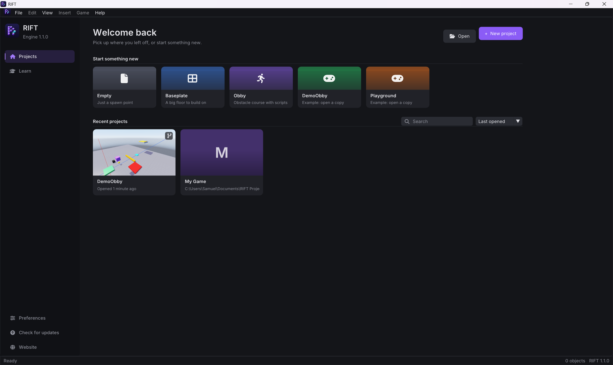
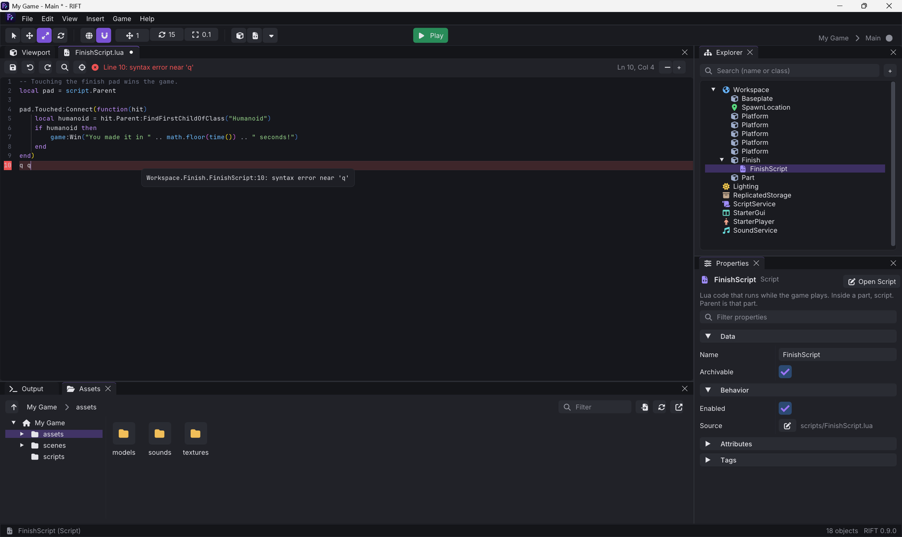
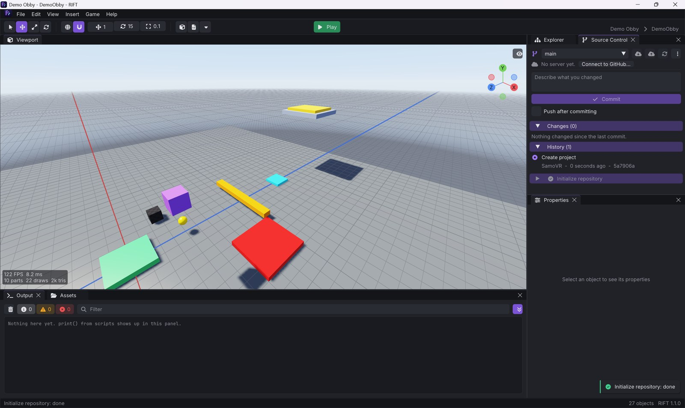
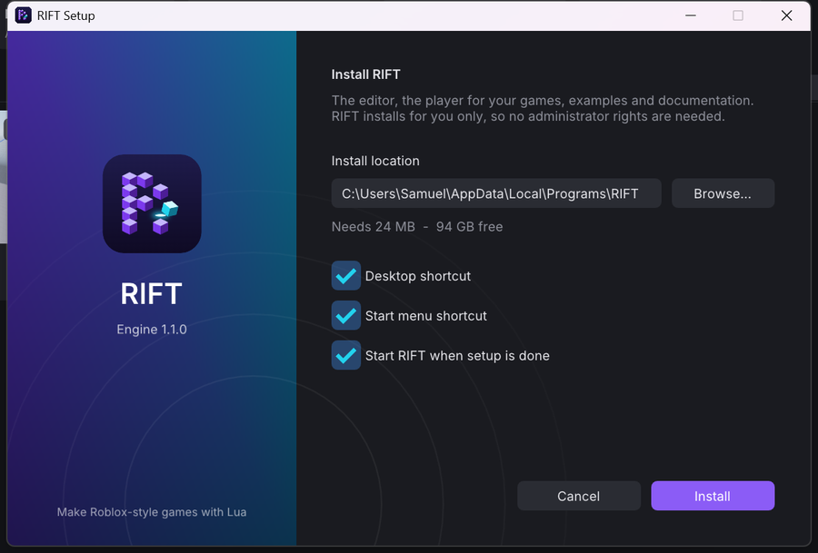

# RIFT

[](https://github.com/SamoVR/RiftEngine/actions/workflows/build.yml)
[](https://github.com/SamoVR/RiftEngine/releases/latest)

RIFT is a 3D game engine and editor in the spirit of Roblox Studio. Build a world
out of parts, script it in Lua with the API you already know from Roblox
(`workspace`, `Instance.new`, `part.Touched:Connect`, `TweenService`, RemoteEvents, ...),
press **Play** to test it, and ship it as a standalone Windows game with one click.

**[Download RIFT for Windows](https://github.com/SamoVR/RiftEngine/releases/latest)** (`RIFT-Setup-<version>.exe`, no administrator rights needed) · [Website](https://samovr.github.io/RiftEngine/) · [Changelog](CHANGELOG.md)


## Features

**Editor**
- Dockable layout: Viewport, Explorer, Properties, Output, Assets, and a script tab per open Lua file
- Roblox Studio controls: fly camera (right mouse + WASD), click / box / Alt selection, move, rotate and face-drag resize gizmos with snapping, local and world axes
- Explorer with search, inline rename, drag-and-drop reparenting and reordering
- Properties generated from the engine's reflection data; editing several objects at once changes one axis on all of them; attributes and tags
- Undo / redo for everything, copy / paste / duplicate (scripts are copied with their objects), group into Models
- Script editor with Lua highlighting, live syntax checking, runtime-error markers and find / replace; files are plain `.lua`, edits from VS Code are picked up live
- Home screen with project cards (a picture of each scene), search, templates (Empty, Baseplate, Obby) and examples
- **Source Control** panel: every project can be a git repository; commit, history, branches, push / pull to GitHub
- Preferences for nearly everything (projects folder, accent colour, anti-aliasing, frame limit, script editor, play and output options), autosave, crash dumps, Discord Rich Presence
- Updates itself from GitHub Releases; installed per user with `RIFT-Setup.exe`

**Game runtime**
- Lua 5.4 with a Roblox-style API: Instances, events, `task`, `RunService`, `UserInputService`, `TweenService`, `CollectionService`, `Debris`, `DataStoreService`, raycasts, `CFrame`, `UDim2`, `Enum`
- Client and server like Roblox: Scripts and LocalScripts, RemoteEvent / RemoteFunction, BindableEvent / BindableFunction, replication; a Client / Server switch while playing
- Jolt Physics: anchored and unanchored parts, welded assemblies, character controller with walking, jumping and steps
- Humanoid characters with health, death and respawning; third- and first-person cameras
- 2D GUI (ScreenGui, Frame, TextLabel, TextButton, ImageLabel, ImageButton) and a leaderboard from `leaderstats`
- Sounds (WAV, MP3, OGG, FLAC), 2D or positional
- Renderer: sun and sky driven by `Lighting.ClockTime`, soft shadows, point and spot lights, materials, fog, tone mapping, MSAA
- 3D models: import OBJ, glTF and GLB as MeshParts

**Shipping**
- **File > Build Game** writes a folder with `YourGame.exe` (using your game's icon), ready to zip and share; nothing has to be installed to play it
- **Game > Run in Player** tests the saved project exactly as players will see it

| | |
|---|---|
|  |  |
|  |  |
|  |  |

## Getting started

1. [Download](https://github.com/SamoVR/RiftEngine/releases/latest) and run `RIFT-Setup-<version>.exe` (or build the solution, below, and run `RiftEditor.exe`).
2. Click **New Project**, pick the **Obby** template, and press **Play** (F5).
3. Insert parts from the toolbar or the **Insert** menu, add a **Script** to a part, and write some Lua:
   ```lua
   local part = script.Parent
   part.Touched:Connect(function(hit)
       local humanoid = hit.Parent:FindFirstChildOfClass("Humanoid")
       if humanoid then humanoid.Health = 0 end
   end)
   ```
4. **File > Build Game** (Ctrl+B) when it is ready.

Read the [user guide](docs/GUIDE.md) for the editor and the [scripting reference](docs/SCRIPTING.md) for the Lua API.

## Building from source

Requirements: Windows 10 or 11 (x64), Visual Studio 2022 or 2026 with the **Desktop development with C++** workload. All libraries are in `third_party/`; nothing else needs to be installed.

1. Open `RiftEngine.sln`.
2. Choose `Release | x64` (or `Debug`) and build the solution. `RiftEditor` is the startup project.
3. Run it. The editor finds its `data/` folder on its own, so the working directory does not matter.

From a Developer Command Prompt:

```
msbuild RiftEngine.sln -p:Configuration=Release -p:Platform=x64 -m
build\bin\Release\RiftTests.exe
```

Everything is written to `build/bin/<Configuration>/`: `RiftEditor.exe`, `RiftPlayer.exe` (the runtime that Build Game copies), `RiftSetup.exe` (the installer stub) and `RiftTests.exe`. Build Game uses the player next to the editor, so make release builds of games from a Release editor. Everything links the C runtime statically, so no Visual C++ redistributable is needed on other machines.

### Making a release

```
python tools/make_installer.py
```

packs `dist/RIFT-Setup-<version>.exe` and `dist/RIFT-<version>-portable.zip` from the Release build. To publish, set the version in `src/core/Version.h`, add a section to `CHANGELOG.md`, commit, and push a tag:

```
git tag v0.1.0
git push origin v0.1.0
```

GitHub Actions builds, tests and publishes the release with the setup attached; installed copies of RIFT then offer the update. The website in `website/` is deployed to GitHub Pages by `.github/workflows/pages.yml` and reads the releases live.

## Repository layout

| Folder | Contents |
|---|---|
| `src/core`, `scene`, `render`, `physics`, `script`, `game`, `audio`, `project`, `platform`, `ui` | The engine (`RiftCore` static library) |
| `src/editor` | RiftEditor.exe: the editor (`panels/` holds the UI panels) |
| `src/player` | RiftPlayer.exe: runs finished games |
| `src/setup` | RiftSetup.exe: installs, updates and uninstalls RIFT |
| `tools/` | Release packaging (`make_installer.py`, `release_notes.py`) |
| `website/` | The website (GitHub Pages) |
| `data/` | Files the engine ships with: shaders, fonts, icons, built-in textures |
| `examples/` | Example projects (open them from the launcher) |
| `tests/` | Unit tests (doctest), including headless rendering tests |
| `third_party/` | Vendored libraries, built as one static library |
| `docs/` | [User guide](docs/GUIDE.md), [scripting reference](docs/SCRIPTING.md), [engine architecture](docs/ENGINE.md) |

Per-user files (settings, window layout, logs) live in `%APPDATA%\RIFT`. Games built with RIFT keep their saves and logs in `%APPDATA%\RIFT Games\<game>`.

## Third-party libraries

Dear ImGui, ImGuizmo, ImGuiColorTextEdit, GLFW, GLEW, GLM, Jolt Physics, Lua 5.4, sol2, miniaudio, stb, nlohmann/json, doctest and the Discord Game SDK; fonts Inter, JetBrains Mono and Font Awesome Free. Their licenses are listed in [third_party/README.md](third_party/README.md) and `data/fonts/`.
