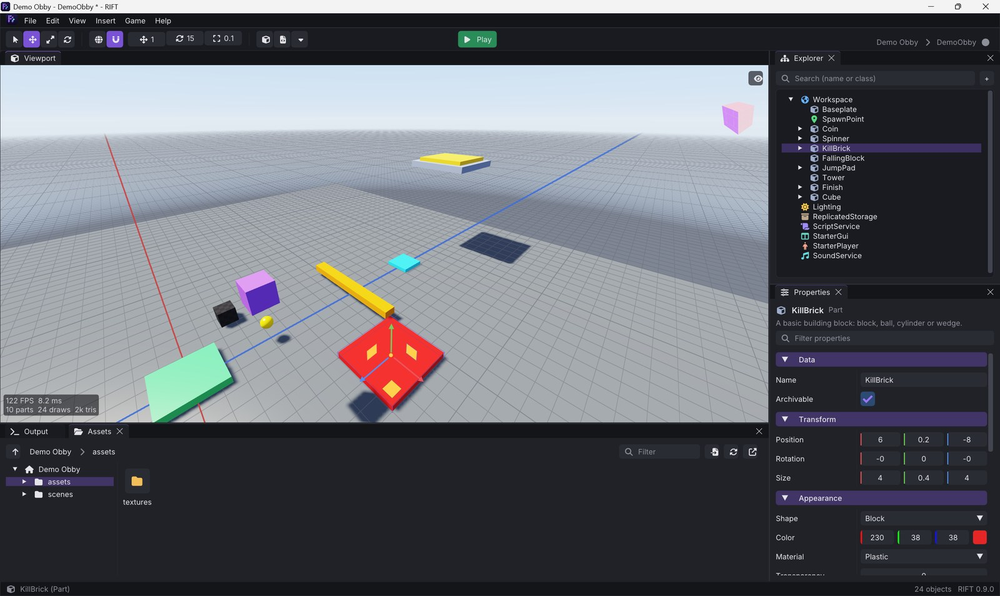
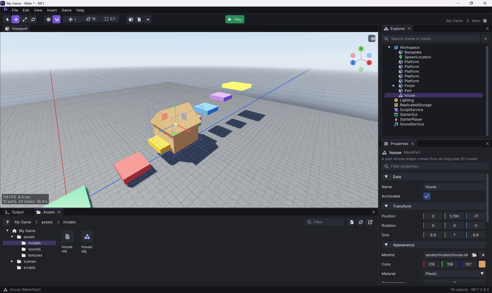
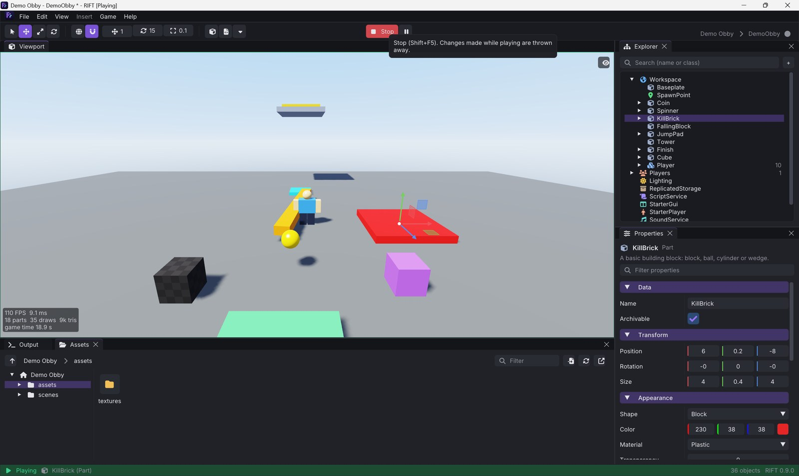
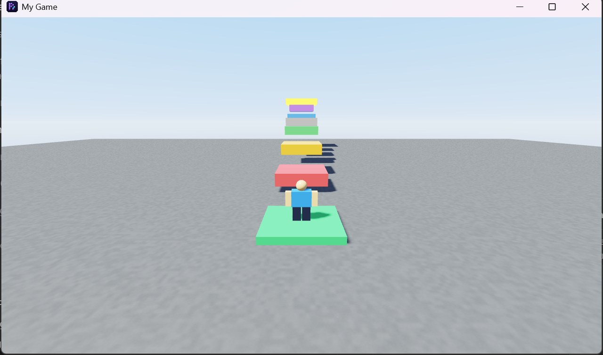

# RIFT user guide

This guide covers the editor: installing, projects and scenes, building worlds,
scripting workflow, testing, version control and shipping a game. The Lua API is
in [SCRIPTING.md](SCRIPTING.md).

## Installing and updating

Download `RIFT-Setup-<version>.exe` from the
[releases page](https://github.com/SamoVR/RiftEngine/releases/latest) and run it.
RIFT installs for you only (into `%LOCALAPPDATA%\Programs\RIFT` by default), so
no administrator rights are needed. It adds Start menu and desktop shortcuts and
an entry in Windows Settings > Apps, which is also where you uninstall it.
Uninstalling never touches your projects.

When a new version is out, RIFT says so when it starts (and in the status bar).
**Help > Check for Updates** shows what is new; **Download and install** updates
RIFT in place and restarts it in a few seconds. Preferences > Updates can turn
the check off or include preview versions.

There is also a portable zip: unzip it anywhere and run `RiftEditor.exe`.

## Projects and scenes

A **project** is a folder:

```
My Game/
    project.json          name, version, start scene, window settings
    scenes/
        Main/
            scene.json    the objects of the scene
            scripts/      the scene's Lua files (one per Script object)
    assets/               textures, sounds and models used by the scenes
        textures/ sounds/ models/
    scripts/              Lua modules shared by every scene (require("Name"))
    Builds/               File > Build Game puts games here by default
```

Everything is plain text (JSON and Lua), so projects work well with git (see
[Source control](#source-control)). Paths in scenes are relative to the project,
so the folder can be moved or shared.

The scenes do not have to live in `scenes/`: File > Project Settings > **Scenes
folder** points the project at any folder inside it (`Levels`, `Content/Scenes`,
...) and can move the existing scenes there.

The **home screen** opens when no project is open. Recent projects are shown as
cards with a picture of the scene as it was last saved (right-click a card to
show it in Explorer or remove it from the list); search and sort them at the top.
**New project** creates one from a template (Empty, Baseplate, Obby) in your
projects folder (`Documents\RIFT Projects` unless you choose another in
Preferences); the template tiles and the examples start one directly. Opening an
example asks where to put your copy. The **Learn** page links to the guides.
Dropping a project folder onto the window opens it too.

**Scenes**: File > New Scene (Ctrl+N), File > Open Scene, File > Save Scene As
(Ctrl+Shift+S). The start scene (the one a built game begins with) is set in
File > Project Settings, along with the game's name, version, icon and window size.

Saving (Ctrl+S) writes the scene and every changed script. Every few minutes an
autosave is written next to the scene (`scene.autosave.json`); your scene file is
only changed when you save. The title bar and toolbar show a dot while there are
unsaved changes, and closing or switching scenes asks before throwing them away.



## The editor window

| Panel | What it does |
|---|---|
| **Viewport** | The 3D scene. While playing it shows the game. |
| **Explorer** | The instance tree: services (Workspace, Lighting, ...), parts, models, scripts. |
| **Properties** | Every property of the selected objects, plus attributes and tags. |
| **Output** | Messages from scripts (`print`, `warn`, errors) and from the engine. |
| **Assets** | The project's files. Drag them into the scene. |
| **Script tabs** | One per open Lua file, next to the Viewport. |

Panels can be moved, docked and tabbed anywhere; View > Reset Layout restores the
default. View also toggles the grid, shadows, wireframe, statistics and the GUI
preview.

### Camera

| Input | Action |
|---|---|
| Right mouse + move | Look around |
| Right mouse + W A S D, Q E | Fly (Shift faster, Ctrl slower) |
| Mouse wheel | Move towards / away from the point under the mouse |
| Middle mouse drag | Pan |
| Alt + left drag | Orbit around the point in the middle of the view |
| F | Frame the selection |
| Axis widget (top right) | Click X, Y or Z to look along that axis |

The eye button in the top right of the viewport sets the camera speed, field of
view and grid step.

### Selecting

- **Click** a part. Parts inside a Model select the whole Model (like Roblox); **Alt + click** selects the part itself.
- **Ctrl or Shift + click** adds or removes objects.
- **Drag on empty space** to select everything in the box.
- In the Explorer: click, Ctrl + click, Shift + click for ranges.
- **Esc** clears the selection; **Ctrl+A** selects everything in Workspace.

### Moving, rotating, resizing

Pick a tool on the toolbar: **Select** (Ctrl+1), **Move** (Ctrl+2), **Scale**
(Ctrl+3) and **Rotate** (Ctrl+4). The globe / cube button switches between world
and local axes (Ctrl+L).

- Move and rotate work on any selection, around the last selected object.
- Scale shows handles on the faces, edges and corners of a part: drag one and the opposite side stays put.
- **Snapping** is on when the magnet is lit; the three fields next to it are the move step (studs), rotation step (degrees) and resize step. Hold **Ctrl** while dragging to ignore snapping for a moment.
- Typing exact numbers in Properties works too; dragging a number field changes it live.

Every change can be undone (Ctrl+Z / Ctrl+Y); the Edit menu shows what will be undone.

### Inserting

The toolbar has buttons for a part and a script; the arrow next to them and the
**Insert** menu have everything else:

- **Parts**: Block, Sphere, Cylinder, Wedge, Corner Wedge, Spawn Location. New parts land on the surface in the middle of the view.
- **Objects**: Model, Folder, Point Light, Spot Light, Sound, value objects.
- **Code**: Script (server), LocalScript (client), ModuleScript, and under Communication: RemoteEvent, RemoteFunction, BindableEvent, BindableFunction. Scripts go inside the selected object, or into ScriptService / StarterPlayerScripts / ReplicatedStorage; remotes into ReplicatedStorage.
- **Effects**: Attachment, ParticleEmitter, Beam and Trail, and ready-made Fire, Smoke, Sparkles, Magic Beam and Speed Trail. Select two parts before inserting a beam to stretch it between them (one part: across it); a trail goes on the selected part. Their attachments are made and linked for you. In the Properties panel, click a colour bar or a curve to edit it.
- **GUI**: ScreenGui, Frame, TextLabel, TextButton, ImageLabel, ImageButton. They go into the selected ScreenGui or Frame, or a new ScreenGui in StarterGui.
- **Gameplay**: ready-made pieces with their scripts: Kill Brick, Spinner, Coin, Jump Pad, Moving Platform, Checkpoint, Door, Finish Line, a Sword and other tools, and a Leaderboard script. Their scripts are ordinary Lua: open them to see how they work. Tools go into StarterPack, so every player spawns with them.

Right-click in the Explorer for the same menu plus Rename (F2), Cut / Copy /
Paste / Paste Into / Duplicate (Ctrl+D), Delete, Group (Ctrl+G), Ungroup
(Ctrl+U), Select Children and **Copy Lua Path** (puts `workspace.Map.Door` on the
clipboard).

Drag objects in the Explorer to move them: drop on a row to put them inside it,
or on the top / bottom edge of a row to place them before / after it. Their
position in the world does not change.

### Terrain

The mountain button in the toolbar (or **View > Terrain Editor**) opens the
Terrain Editor:

- **Create**: pick the area, the height, how hilly and mountainous it is, water and caves, then **Generate**. A different **Seed** gives different land. **Clear Terrain** removes all of it.
- **Edit**: brushes you drag over the land in the viewport. **Add** and **Subtract** build and carve, **Grow** and **Erode** raise and wear the surface gently, **Smooth** rounds it off, **Flatten** levels it to the height where you start the stroke (or a fixed height), **Paint** changes only the material. Hold **Ctrl** to reverse a brush (Add ↔ Subtract, Grow ↔ Erode) and **Shift** to smooth. **[** and **]** change the size, **Esc** goes back to selecting. Pick the material from the swatches under the brush settings.
- **Colours**: the water's colour and transparency, and the colour of every terrain material.

Every stroke, Generate and Clear is one undo step (Ctrl+Z). Terrain is saved
next to the scene as `terrain.bin`.

### Animations

The running-figure button in the toolbar (or **View > Animation Editor**)
opens the Animation Editor under the viewport. **Insert > Animation >
Character Rig** adds a body shaped like the players' characters to practise on.

1. Select the rig (any model with a Humanoid or AnimationController and Motor6D joints) and click **Edit**.
2. Move the red line on the timeline to a time and pose the rig with the **Rotate** and **Move** tools: limbs turn around their joints, and every change is keyed at that time (diamonds appear on the joint's row).
3. Drag diamonds to move keys (Shift: no snapping), right-click one for its easing, Delete removes the selected key. **Key All** keys every joint as it is now. Name a keyframe to get `KeyframeReached` events.
4. Set the **Priority** and **Loop**, press Play to preview, and **Save**: the animation goes to `assets/animations/<Name>.anim`, which is its AnimationId. The **+** button also adds an Animation object with that id to ReplicatedStorage.

The open button lists the game's animations and the built-in ones (opening a
built-in one makes a copy to change).

### Assets

The Assets panel shows the project folder. Drag files from Windows Explorer onto
the editor window to import them (images go to `assets/textures`, sounds to
`assets/sounds`, models to `assets/models`). Then drag them from the Assets panel:

| Drop this | onto | and you get |
|---|---|---|
| Image | a part | the part's Texture |
| Image | a GUI element | an ImageLabel, or the image of an ImageLabel / ImageButton |
| Sound | a part | a 3D Sound in that part |
| Sound | empty space | a Sound in SoundService |
| Model (.obj, .gltf, .glb) | anywhere | a MeshPart with the model's size, colour and texture |
| scene.json | anywhere | opens that scene |

Asset properties (Texture, SoundId, MeshId, Image) also accept a dropped file or
a file chosen with the folder button; files from outside the project are copied
into its assets folder.



### GUI

ScreenGuis in StarterGui are drawn over the viewport while editing (View > GUI
While Editing). Click an element to select it and drag a selected element to move
it. Sizes and positions are UDim2 values: a fraction of the parent (Scale) plus
pixels (Offset), edited per axis in Properties.

## Scripts

A **Script** is an object in the Explorer and a `.lua` file in the scene's
`scripts/` folder. Double-click it (or press Enter on it) to open it.

- The editor checks the syntax as you type: the line with an error turns red and the toolbar shows the message (click it to jump there).
- Errors while playing are shown in the Output; click a line to jump to the script and line. The tab marks the line too.
- Ctrl+S saves (while playing it saves just that file); Ctrl+F finds and replaces; the +/- buttons change the text size.
- The files are plain Lua, so you can also edit them in VS Code or any other editor: changes are picked up within a second. If a script was changed on disk *and* has unsaved edits in RIFT, your RIFT version is kept and you are told.
- Duplicating or pasting an object gives its scripts their own copies of the files.
- **ModuleScripts** return a value and are loaded with `require(module)`. Modules in the project's `scripts/` folder are shared by all scenes: `require("Name")` loads `scenes/<scene>/scripts/Name.lua` if it exists, else `scripts/Name.lua`.

See [SCRIPTING.md](SCRIPTING.md) for the API.

## Playing

**Play** (F5) runs the scene in the viewport. The game runs on a copy of the
scene: whatever it changes (moved parts, destroyed objects, new instances) is
thrown away on **Stop** (Shift+F5). **Pause** (F6) freezes the game.

- Click the viewport to give the game the keyboard and mouse. The character walks with W A S D, jumps with Space, and the camera turns with the right mouse button. **Esc** gives the mouse back to the editor.
- **Test players**: the button next to Play sets how many players join (1 to 8). Each gets a character and its own client; while playing, the player list next to the Client / Server switch picks whose view you see and control.
- The game runs as a **server** and a **client**, like Roblox. The **Client / Server** switch in the toolbar picks which one you see. Client: the player's view, where you play. Server: the server's world with the editor camera, where you can select and move objects and watch the change reach the client.
- The Explorer shows the world you are looking at, so it lists the client's objects (PlayerGui, PlayerScripts, whatever LocalScripts create) on the Client side and the server's on the Server side. Output lines are tagged Client or Server.
- `print` output appears in the Output panel with the game time.
- **Game > Run in Player** (Ctrl+F5) saves and starts the standalone player on the project, exactly as a finished game will run.



## Source control

RIFT works with **Git** (install [Git for Windows](https://git-scm.com/download/win)
once). The **Source Control** panel (a tab next to the Explorer; View > Source
Control) shows the project's repository:

- **Initialize repository** turns a project into one, with a `.gitignore` that leaves out builds and autosaves. New projects can start as repositories (the checkbox in New Project, or Preferences > Source Control).
- **Changes** lists the files that differ from the last commit. Write a message and **Commit** (Ctrl+Enter): the scene is saved first and every change is recorded. Right-click a file to discard its changes.
- **History** lists the commits; right-click one to copy its id or open it on GitHub.
- The **branch** box switches branches or creates a new one; the project reloads with that branch's files.
- **Push** and **Pull** send and get commits. To back the project up on GitHub, create an empty repository there and paste its address under "Connect to GitHub". Signing in happens in Git's own window the first time.

The first commit asks for your name and email if git does not know them yet.

## Building a game

**File > Build Game** (Ctrl+B) creates a folder (by default `Builds/<Game>` in
the project) with:

```
My Game.exe      the RIFT player, renamed, with the game's icon (Project Settings > Icon)
data/            the engine files the game needs
game/            project.json, scenes, scripts, assets
```

Zip the folder and share it; nothing else has to be installed. Building again
into the same folder replaces the previous build, and RIFT refuses to build into
a folder that has other files in it. Unsaved changes are saved first.

In the game, **Esc** opens a menu (Resume, Restart, Fullscreen, Quit), F11 or
Alt+Enter toggles fullscreen. Saves made with DataStoreService go to
`%APPDATA%\RIFT Games\<game>\datastores`.



## Preferences

Edit > Preferences (Ctrl+,), by category:

| Category | Settings |
|---|---|
| General | Projects folder, reopening the last project, autosave interval, asking before deleting, Discord presence |
| Appearance | Interface size, accent colour, tooltips, statistics, which panels are shown, resetting the layout |
| Viewport | Grid, GUI preview, shadows, wireframe, anti-aliasing, V-Sync, frame rate limit, slowing down in the background, camera speed, sensitivity, field of view, inverted mouse |
| Editing | Snapping and its steps, local axes |
| Scripts | Text size, tab width, whitespace, mini map, closing brackets, the external editor (for example VS Code) |
| Playing | Clearing the Output, saving before playing, pausing on script errors |
| Output | Game time on each line, how many lines to keep |
| Source Control | Where git is, git for new projects, pushing after each commit |
| Updates | Checking at start-up, preview versions, checking now |

**Reset to defaults** keeps your recent projects and layout. Preferences are
stored in `%APPDATA%\RIFT\settings.json`.

## Keyboard shortcuts

Help > Keyboard Shortcuts lists them in the editor.

| Keys | Action |
|---|---|
| F5 / Shift+F5 / F6 | Play / Stop / Pause |
| Ctrl+F5 | Run in the standalone player |
| Ctrl+S / Ctrl+Shift+S | Save / Save As |
| Ctrl+N / Ctrl+Shift+N / Ctrl+O | New scene / New project / Open project |
| Ctrl+B | Build game |
| Ctrl+Z / Ctrl+Y | Undo / Redo |
| Ctrl+C / Ctrl+X / Ctrl+V / Ctrl+Shift+V | Copy / Cut / Paste / Paste into |
| Ctrl+D / Del | Duplicate / Delete |
| Ctrl+G / Ctrl+U | Group / Ungroup |
| Ctrl+A / Esc | Select all / Clear selection |
| Ctrl+1 / 2 / 3 / 4 | Select / Move / Scale / Rotate tool |
| Ctrl+L | Local / world axes |
| F2 / F | Rename / Zoom to selection |
| Ctrl+, | Preferences |

## Files and troubleshooting

- Settings, window layout and logs: `%APPDATA%\RIFT` (`logs\editor.log`; Help > Open Log File). The previous session's log is kept as `editor.previous.log`.
- If the editor crashes, `logs\editor-crash.dmp` is written next to the log.
- A model that cannot be loaded is drawn as a block and the reason is in the Output.
- The editor needs OpenGL 3.3; if it does not start, update the graphics driver.
