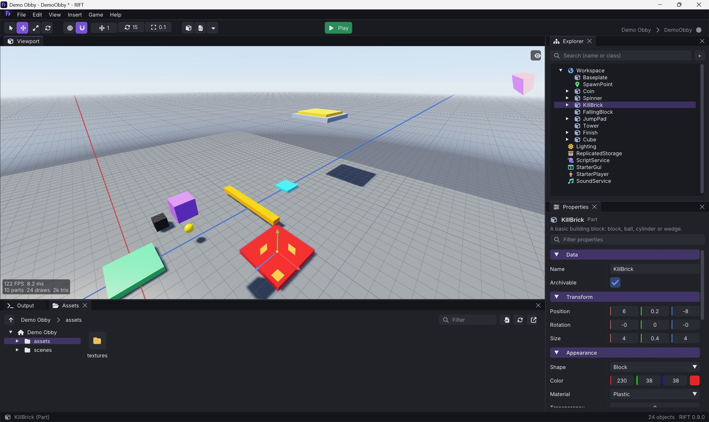
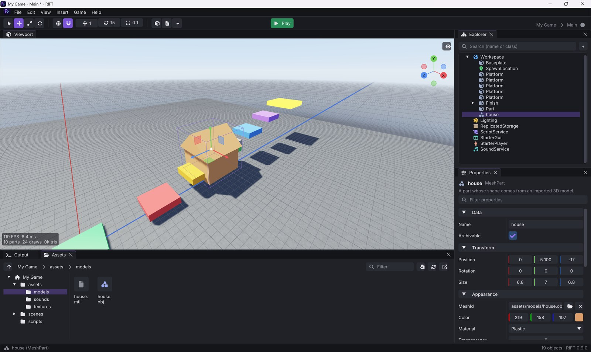
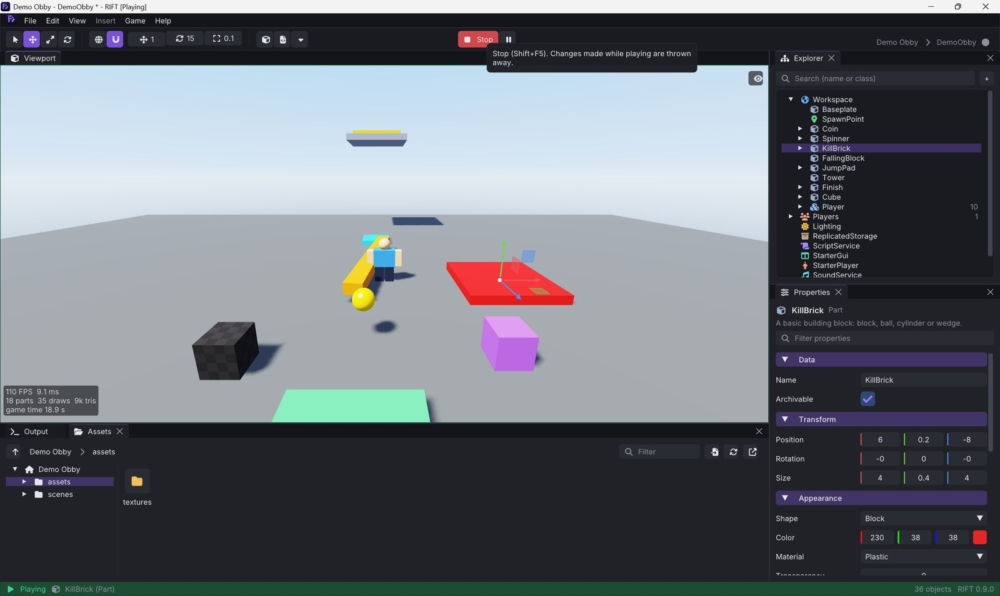
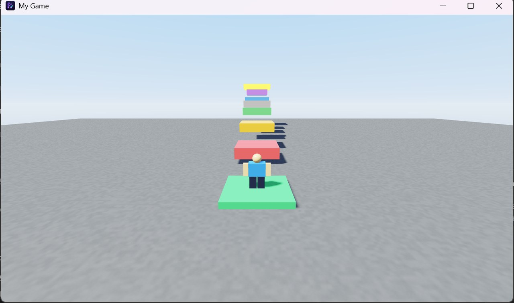

# RIFT user guide

This guide covers the editor: installing, projects and scenes, building worlds,
scripting workflow, testing, version control and shipping a game. The Lua API is
in [SCRIPTING.md](SCRIPTING.md).

## New here?

Start RIFT and press **Learn > Start the Tutorial** (or **Help > Start the Tutorial**
with a project open). It takes about five minutes and makes a small game in a project
of its own.

## Installing and updating

RIFT comes with [Samo Launcher](https://samovr.github.io/Launcher/). Install the launcher, make
your free account, then open its **RIFT** page and press **Install**. No
administrator rights are needed. The launcher also keeps RIFT up to date, and
its RIFT page is where you uninstall it. Uninstalling never touches your
projects.

RIFT needs you to be signed in to Samo Launcher. You can open RIFT from the
launcher or by itself: opened by itself, it finds the launcher and starts it if
it is closed. If nobody is signed in, RIFT shows a sign-in screen with a button
that opens the launcher.

## Your account

Your name and avatar are in the top right corner of the editor. Click it to see
your level, your roles and your license, to open **Edit Avatar**, **View
Profile** or **Account Settings** in Samo Launcher, and to sign out. The same
avatar is your character when you press Play and when you play online.

**Show friends what I'm editing** lets your friends see "Editing <your place>
in RIFT" next to your name in the launcher. Untick it to keep that to yourself.

## Safe mode

A place that was not made on your computer (one you downloaded, or a template
someone published) opens in **safe mode**: you can look at everything and read
every script, but Play, hosting, Run in Player and Build are off, so none of
its scripts run. RIFT shows how many scripts the place has and points at lines
worth reading first, such as a module loaded by number or text spelled out in
numbers. Click **Trust this place** to switch safe mode off for it; the orange
**Safe mode** note in the status bar opens the question again.

Scripts in RIFT can never reach your files, other programs or the internet,
trusted or not. Safe mode is there so that a script you have not read does not
get to spoil a game you are about to work on.

## Projects and scenes

A **project** is a folder:

```
My Game/
    project.json          name, version, start scene, window settings
    scenes/
        Main/
            scene.json    the objects of the scene
            scripts/      the scene's Lua files (one per Script object)
    assets/               textures, sounds and models used by the scenes
        textures/ sounds/ models/
    scripts/              Lua modules shared by every scene (require("Name"))
    Builds/               File > Build Game puts games here by default
```

Everything is plain text (JSON and Lua), so projects work well with git (see
[Source control](#source-control)). Paths in scenes are relative to the project,
so the folder can be moved or shared.

The scenes do not have to live in `scenes/`: File > Project Settings > **Scenes
folder** points the project at any folder inside it (`Levels`, `Content/Scenes`,
...) and can move the existing scenes there.

The **home screen** opens when no project is open. Recent projects are shown as
cards with a picture of the scene as it was last saved (right-click a card to
show it in Explorer or remove it from the list); search and sort them at the top.
**New project** creates one from a template (Empty, Baseplate) in your
projects folder (`Documents\RIFT Projects` unless you choose another in
Preferences); the template tiles and the examples start one directly. Opening an
example asks where to put your copy. The **Learn** page links to the guides.
Dropping a project folder onto the window opens it too.

**Crystal Isles** is the example to learn from: a complete little game (a menu,
a countdown, a two-minute gem race across floating islands, combos, launch and
speed pads, a moving platform, results with a best score) built only with what
the editor offers. Things worth opening in it:

- `ScriptService > RoundManager`: the server runs the rounds; `WorldScript` drives the pads and the platform (found by their tags).
- `StarterPlayer > StarterPlayerScripts > ClientMain`: the menu, HUD and results, all animated with TweenService; `ClientEffects` spins the gems and bursts them into sparkles.
- `StarterGui`: the three screens (MenuGui, HudGui, ResultsGui). They start disabled so they don't cover the world while you edit; tick Enabled to work on one.
- `ReplicatedStorage > Config`: round length, gem points, speeds. Change a number and play.
- `ServerStorage > GemTemplates`: the gems are made of CornerWedges; `Workspace > Pip` is an animated guide (the Wave animation is in `assets/animations`).

**FPS Range** shows the newer graphics and first-person features: rifle, pistol
and shotgun with recoil and reloading, a viewmodel in a ViewportFrame, moving
targets and a timed round, through a portal. The **Go Kart** in the Toolbox shows
constraints and a VehicleSeat.

**Canyon** is a walk along a river through a desert canyon, to show how real RIFT can
look. Its rock, sand and plants are free photo scans from Poly Haven (see
`assets/CREDITS.txt`). It needs a good graphics card: if it runs slowly, turn things
off in the Esc menu's Graphics, the most helpful being Terrain relief and Light in the air.

**Brookfield** is a small town with things to do, made to show what RIFT 0.7.0 can do:
drive the car through the tunnel to the lake, let the smoke out of a burning warehouse and
put the fire out, knock down targets at the police range, sit in the café, talk to the
townspeople, and stay out until the street lights come on. The blue kiosk by the town hall
(or G) opens the town guide. Its scripts are in `ScriptService` and
`StarterPlayer > StarterPlayerScripts`; `tools/make_town.py` in RIFT's source builds the
whole town. The houses, shops and cars are Kenney's free models (`assets/CREDITS.txt`).

**Scenes**: File > New Scene (Ctrl+N), File > Open Scene, File > Save Scene As
(Ctrl+Shift+S). The start scene (the one a built game begins with) is set in
File > Project Settings, along with the game's name, version, icon and window size.

Saving (Ctrl+S) writes the scene and every changed script. Every few minutes an
autosave is written next to the scene (`scene.autosave.json`); your scene file is
only changed when you save. The title bar and ribbon show a dot while there are
unsaved changes, and closing or switching scenes asks before throwing them away.



## The editor window

| Panel | What it does |
|---|---|
| **Viewport** | The 3D scene. While playing it shows the game. |
| **Explorer** | The instance tree: services (Workspace, Lighting, ...), parts, models, scripts. |
| **Properties** | Every property of the selected objects, plus attributes and tags. |
| **Output** | Messages from scripts (`print`, `warn`, errors) and from the engine. |
| **Assets** | The project's files. Drag them into the scene. |
| **Script tabs** | One per open Lua file, next to the Viewport. |

Panels can be moved, docked and tabbed anywhere; View > Reset Layout restores the
default. View also toggles the grid, shadows, wireframe, statistics and the GUI
preview.

### Camera

| Input | Action |
|---|---|
| Right mouse + move | Look around |
| Right mouse + W A S D, Q E | Fly (Shift faster, Ctrl slower) |
| Mouse wheel | Move towards / away from the point under the mouse |
| Middle mouse drag | Pan |
| Alt + left drag | Orbit around the point in the middle of the view |
| F | Frame the selection |
| Axis widget (top right) | Click X, Y or Z to look along that axis |

The eye button in the top right of the viewport sets the camera speed, field of
view and grid step.

### Selecting

- **Click** a part. Parts inside a Model select the whole Model (like Roblox); **Alt + click** selects the part itself.
- **Ctrl or Shift + click** adds or removes objects.
- **Drag on empty space** to select everything in the box.
- In the Explorer: click, Ctrl + click, Shift + click for ranges.
- **Esc** clears the selection; **Ctrl+A** selects everything in Workspace.

### Moving, rotating, resizing

Pick a tool on the ribbon (Home or Model tab): **Select** (Ctrl+1), **Move**
(Ctrl+2), **Scale** (Ctrl+3), **Rotate** (Ctrl+4) and **Transform** (Ctrl+5). The
**World / Local** button on the Model tab switches the axes (Ctrl+L).

- Move and rotate work on any selection, around the last selected object.
- Scale shows a coloured ball on each side of a part: drag one and the opposite side stays put. Hold **Ctrl** to resize both sides at once and **Shift** to keep the proportions.
- Transform shows a box around the part with handles on its faces, edges and corners, for resizing in several directions at once.
- **Snap** on the Model tab is lit when snapping is on; the three fields next to it are the move step (studs), rotation step (degrees) and resize step. Hold **Ctrl** while dragging to ignore snapping for a moment.
- Typing exact numbers in Properties works too; dragging a number field changes it live.

Every change can be undone (Ctrl+Z / Ctrl+Y); the Edit menu shows what will be undone.

### Colours and materials

**Color** on the ribbon colours the selected parts (and the parts in
selected models); the bar under it shows their colour. Its palette has
Roblox's 64 BrickColors, the colours you used last, a picker and a hex field.
The button next to it changes their **material**: a grid of every material
with a preview, grouped and searchable. In Properties, the palette button next
to any colour and the Material field open the same pickers.

**View > Materials** opens the Materials panel: 22 ready-made looks (wood,
metal, glass, stone and more) and your own, each shown on a ball and a block.
Pick one, change its base material, colour, transparency, reflectance and
textures (colour, normal, roughness and so on, with their tiling), then **Apply
to selected**. **From selected** starts from a part's look, and **Save in
project** keeps it with the project for every scene in it.

### Graphics

**Lighting** in the Explorer holds what the game looks like: `HDR`, `SoftShadows`,
`AmbientOcclusion` and `ScreenSpaceReflections` are switches in its properties, and
post effects are objects inside it (**Insert > Post Effects**: Bloom, Sun Rays, Color
Correction, Blur, Depth Of Field). New projects start with these on, and a little
bloom and sun rays. Projects from before RIFT 0.4 keep their old look until you
turn them on.

Each can also be turned off for this computer alone, without changing the game: the
**Graphics** group on the ribbon's **View** tab (and **Preferences**), and **Graphics**
in the Esc menu of a built game.

### Photo-real looks

Good scans do most of the work: free ones are at polyhaven.com and ambientcg.com.

1. In **Lighting**, tick **RealisticLighting** and **AutoExposure**, and insert an **Atmosphere** (Insert > Objects). Keep HDR on.
2. Import a glTF model as a MeshPart: it brings its own textures. Or insert a **Surface Appearance** into a part and fill in its maps, with **TextureScale** set to the studs one repeat should cover.
3. For terrain, put a Surface Appearance under **Terrain** for each group of materials you use. There are four: soil (Grass, Ground, Mud), sand (Sand, Snow, Salt), rock (Rock, Slate, Basalt and the rest) and sandstone (Sandstone, Limestone). **Displacement** gives it real relief up close.
4. Insert a **Scatter** under Terrain for plants and stones: a model, a material to grow on, and how many.
5. Set **Terrain.WaterFlow** to make rivers run.

Lighting then comes from the sky, so **Ambient** only stands for light bounced off the world: warm and low in a canyon, for example.

### Portals

**Insert > Portal Pair** makes two doors that lead into each other. Stand them
anywhere: you see through one what is beyond the other, and characters, loose parts
and the camera pass through as if the two doors were one. Nothing fades or jumps, so
spaces can be bigger inside than outside, or a corridor can come back to where it
started.

- A portal is a **Portal** object inside a part. Its **Face** is the side of the part that is the window, and its **Target** is where it leads. For a one-way door, leave the other's Target empty.
- The door part must have **CanCollide** off, and any wall behind it needs an opening: things go through when their middle passes the face.
- Portals can look into portals. **RecursionDepth** says how deep the view goes (3 at first); each level costs another view of the scene, and there are at most 12 views a frame.

### Inserting

The ribbon's Home tab has buttons for a part and a script; **More** and the
**Insert** menu have everything else:

- **Parts**: Block, Sphere, Cylinder, Wedge, Corner Wedge, Spawn Location, Seat (characters sit on it), Vehicle Seat (sit down and drive the hinges in its model). New parts land on the surface in the middle of the view.
- **Objects**: Model, Folder, Proximity Prompt (into the selected part: "E Interact" for players nearby), Constraints (Hinge, Ball Socket, Prismatic, Rod, Rope, Spring, Weld, No Collision; see the [scripting reference](SCRIPTING.md#constraints)), Point Light, Spot Light, Sound, value objects.
- **Code**: Script (server), LocalScript (client), ModuleScript, and under Communication: RemoteEvent, RemoteFunction, BindableEvent, BindableFunction. Scripts go inside the selected object, or into ScriptService / StarterPlayerScripts / ReplicatedStorage; remotes into ReplicatedStorage.
- **Effects**: Attachment, ParticleEmitter, Beam and Trail, and ready-made Fire, Smoke, Sparkles, Magic Beam and Speed Trail. Select two parts before inserting a beam to stretch it between them (one part: across it); a trail goes on the selected part. Their attachments are made and linked for you. In the Properties panel, click a colour bar or a curve to edit it.
- **GUI**: ScreenGui, Frame, TextLabel, TextButton, ImageLabel, ImageButton. They go into the selected ScreenGui, BillboardGui, SurfaceGui or Frame, or a new ScreenGui in StarterGui. **BillboardGui** (floats over the selected part, facing the camera) and **SurfaceGui** (covers a face of it) start with a label.
- **Gameplay**: ready-made pieces with their scripts: Kill Brick, Spinner, Coin, Jump Pad, Moving Platform, Checkpoint, Door, Finish Line, a Sword and other tools, and a Leaderboard script. Their scripts are ordinary Lua: open them to see how they work. Tools go into StarterPack, so every player spawns with them.

The **+** at the end of the Explorer row under the mouse opens the same list
and inserts into that object, as in Roblox Studio.

Right-click in the Explorer for the same menu plus Rename (F2), Cut / Copy /
Paste / Paste Into / Duplicate (Ctrl+D), Delete, Group (Ctrl+G), Ungroup
(Ctrl+U), Select Children and **Copy Lua Path** (puts `workspace.Map.Door` on the
clipboard).

Drag objects in the Explorer to move them: drop on a row to put them inside it.
Their position in the world does not change. The Explorer lists things as Roblox
Studio does: the services in its order, and inside them Camera and Terrain first,
then everything by name.

### Terrain

**Terrain** on the ribbon (or **View > Terrain Editor**) opens the
Terrain Editor:

- **Create**: pick the area, the height, how hilly and mountainous it is, water and caves, then **Generate**. A different **Seed** gives different land. **Clear Terrain** removes all of it.
- **Edit**: brushes you drag over the land in the viewport. **Add** and **Subtract** build and carve, **Grow** and **Erode** raise and wear the surface gently, **Smooth** rounds it off, **Flatten** levels it to the height where you start the stroke (or a fixed height), **Paint** changes only the material. Hold **Ctrl** to reverse a brush (Add ↔ Subtract, Grow ↔ Erode) and **Shift** to smooth. **[** and **]** change the size, **Esc** goes back to selecting. Pick the material from the swatches under the brush settings.
- **Colours**: the water's colour and transparency, and the colour of every terrain material.

Every stroke, Generate and Clear is one undo step (Ctrl+Z). Terrain is saved
next to the scene as `terrain.bin`.

### Animations

**Animation** on the ribbon (or **View > Animation Editor**)
opens the Animation Editor under the viewport. **Insert > Animation >
Character Rig** adds a body shaped like the players' characters to practise on.

1. Select the rig (any model with a Humanoid or AnimationController and Motor6D joints) and click **Edit**.
2. Move the red line on the timeline to a time and pose the rig with the **Rotate** and **Move** tools: limbs turn around their joints, and every change is keyed at that time (diamonds appear on the joint's row).
3. Drag diamonds to move keys (Shift: no snapping), right-click one for its easing, Delete removes the selected key. **Key All** keys every joint as it is now. Name a keyframe to get `KeyframeReached` events.
4. Set the **Priority** and **Loop**, press Play to preview, and **Save**: the animation goes to `assets/animations/<Name>.anim`, which is its AnimationId. The **+** button also adds an Animation object with that id to ReplicatedStorage.

**Hold** puts a tool in the rig's right hand while you animate: pick one from
the game, and its Handle hangs from a `RightGrip` joint in the hand. That joint
has its own row on the timeline, named "Handle": key it like a limb to swing a
sword or aim a gun, and the game moves the tool the same way.

The open button lists the game's animations and the built-in ones (opening a
built-in one makes a copy to change).

### Assets

The Assets panel shows the project folder. Drag files from Windows Explorer onto
the editor window to import them (images go to `assets/textures`, sounds to
`assets/sounds`, models to `assets/models`). Then drag them from the Assets panel:

| Drop this | onto | and you get |
|---|---|---|
| Image | a part | the part's Texture |
| Image | a GUI element | an ImageLabel, or the image of an ImageLabel / ImageButton |
| Sound | a part | a 3D Sound in that part |
| Sound | empty space | a Sound in SoundService |
| Model (.obj, .gltf, .glb) | anywhere | a MeshPart with the model's size, colour and texture |
| scene.json | anywhere | opens that scene |

Asset properties (Texture, SoundId, MeshId, Image) also accept a dropped file or
a file chosen with the folder button; files from outside the project are copied
into its assets folder.



### Toolbox

The **Toolbox** (View > Toolbox, a tab next to Assets) is a library of models
you can drop into any project. **RIFT** has ready-made ones (a door that opens
with E, a bench to sit on, a sign, a street lamp, a tree, a treasure chest);
**My Models** are the ones you saved. Click a card to put it in the middle of
the view, or drag it to where it should go; one Ctrl+Z takes it out again.

To save your own, select it and press **Save Selection** (or right-click it in
the Explorer > **Save to Toolbox**). Its scripts and the images, models and
sounds it uses are saved with it, and copied into a project when you insert it.
Right-click a card to rename it, delete it, make a new picture of it or find its
folder (`%APPDATA%/RIFT/Toolbox`).

### GUI

ScreenGuis in StarterGui are drawn over the viewport while editing (View > GUI
While Editing). Click an element to select it and drag a selected element to move
it. Sizes and positions are UDim2 values: a fraction of the parent (Scale) plus
pixels (Offset), edited per axis in Properties. Text has a **Font**, an outline
(**TextStrokeTransparency**) and can fill its element (**TextScaled**); any
element can be turned (**Rotation**). Insert > GUI > UIGradient (with an element
selected) shades it with a gradient.

A selected element has handles: drag a corner or an edge to resize it (the
opposite side stays put). The bar over the viewport lines elements up (left,
centre, right, top, middle, bottom) and switches Size and Position between Scale
and pixels at a click. **Preview** shows the GUI as it looks on a phone, a
tablet, a laptop or a big screen, to check it fits everywhere. A
**UISizeConstraint** keeps an element between a smallest and a largest size, and
a **UIPageLayout** turns its children into pages that slide from one to the next.

GUI in the world shows in the viewport too: a **BillboardGui** in a part floats
over it (Size's Scale is in studs, so it shrinks with distance; Offset is in
pixels), and a **SurfaceGui** is drawn on the face its `Face` property picks,
like a sign. Its `CanvasSize` is the face in GUI pixels (or use `SizingMode`
PixelsPerStud).

## Scripts

A **Script** is an object in the Explorer and a `.lua` file in the scene's
`scripts/` folder. Double-click it (or press Enter on it) to open it.

- The editor checks the syntax as you type: the line with an error turns red and the script's bar shows the message (click it to jump there).
- Errors while playing are shown in the Output; click a line to jump to the script and line. The tab marks the line too.
- **Suggestions** pop up as you type, and after `.` or `:`: the Lua keywords, the API (`game`, `workspace`, `Vector3.new`, `Enum.Material.Grass`, ...), the names in your file, and the members of what is before the dot: `workspace.Map.` lists Map's children, properties and events, `game:GetService("Players").` the Players service's, `script.Parent.` those of the script's part, and simple locals (`local door = workspace.Door`) are followed too. Tab or Enter takes one; Ctrl+Space asks for them.
- Ctrl+S saves (while playing it saves just that file); Ctrl+F finds and replaces in the file; the +/- buttons change the text size.
- **Find in Scripts** (Ctrl+Shift+F, also in the View menu) searches every script of the scene as you type; click a result to open the script at that line. Replace All changes them all (in the editor; saving writes them).
- The files are plain Lua, so you can also edit them in VS Code or any other editor: changes are picked up within a second. If a script was changed on disk *and* has unsaved edits in RIFT, your RIFT version is kept and you are told.
- Duplicating or pasting an object gives its scripts their own copies of the files.
- **ModuleScripts** return a value and are loaded with `require(module)`. Modules in the project's `scripts/` folder are shared by all scenes: `require("Name")` loads `scenes/<scene>/scripts/Name.lua` if it exists, else `scripts/Name.lua`.

See [SCRIPTING.md](SCRIPTING.md) for the API.

## Playing

**Play** (F5) runs the scene in the viewport. The game runs on a copy of the
scene: whatever it changes (moved parts, destroyed objects, new instances) is
thrown away on **Stop** (Shift+F5). **Pause** (F6) freezes the game.

- Click the viewport to give the game the keyboard and mouse. The character walks with W A S D, jumps with Space, and the camera turns with the right mouse button. **Esc** gives the mouse back to the editor.
- Tools: the number keys equip the tools on the backpack bar; <kbd>`</kbd> (the key left of 1) opens the inventory with all of them, a search box, and slots to drag them into.
- Chat: <kbd>/</kbd> opens the chat box (top left), Enter says it to every player, with a bubble over your character's head.
- **Test players**: the button next to Play sets how many players join (1 to 8). Each gets a character and its own client; while playing, the player list next to the Client / Server switch picks whose view you see and control.
- The game runs as a **server** and a **client**, like Roblox. The **Client / Server** switch next to Stop picks which one you see. Client: the player's view, where you play. Server: the server's world with the editor camera, where you can select and move objects and watch the change reach the client.
- The Explorer shows the world you are looking at, so it lists the client's objects (PlayerGui, PlayerScripts, whatever LocalScripts create) on the Client side and the server's on the Server side. Output lines are tagged Client or Server.
- `print` output appears in the Output panel with the game time.
- **Game > Run in Player** (Ctrl+F5) saves and starts the standalone player on the project, exactly as a finished game will run.



### Playing online

One computer hosts, and others join it by its address. Everyone needs the same
game: the same project, or the same built game. Scripts and assets are not sent,
only the world and what happens in it. Up to 32 players can join.

**In the editor**, on the ribbon's Test tab, in the **Online** group:

- **Host**: choose a port (53640 unless you change it) and press **Start hosting**. The game starts, and others can join until you press Stop.
- **Join**: type the address, and a name if you like, and press **Join**. Open the same project first.

**In a built game**: press Esc and open **Online**. Host restarts the game for
everyone to join; Join takes an address like `192.168.1.20`, or `192.168.1.20:53641`
with another port. Other people playing means the menu does not pause anything,
and the game keeps running when its window is minimized.

**From the command line**, for a built game or the player:

```
MyGame.exe --host [port]
MyGame.exe --join <address[:port]>
MyGame.exe --server [port]
MyGame.exe --name <your name>
```

`--server` is a dedicated server: no window of its own beyond a console showing
what scripts print, and no player of its own, only the ones who join. Close it to
stop it.

**Getting through**: on the same network, use the host's local address. Across the
internet, the host's router must forward the port (TCP) to the host's computer, and
others use its public address. Windows asks the first time whether to let the
program through its firewall: allow it. Only join people you trust, and only host
for people you trust: a player's own computer says where its character is.

## Source control

RIFT works with **Git** (install [Git for Windows](https://git-scm.com/download/win)
once), laid out like Visual Studio's source control. Everything is also in the
**Git** menu.

**Git Changes** (a tab next to the Explorer) is where you commit:

- **Create Git Repository** turns a project into one, with a `.gitignore` that leaves out builds and autosaves. New projects can start as repositories (the checkbox in New Project, or Preferences > Source Control).
- The top row picks the **branch** (or checks out one from the server), and has **Fetch**, **Pull** (with how many commits are waiting), **Push** (with how many are yours) and **Sync** (pull, then push).
- **Changes** lists the files that differ from the last commit; **Staged Changes** the ones going into the next commit. Hover a file for **+** (stage), **-** (unstage) and undo; click it to see its diff. **Commit Staged** records what is staged, or **Commit All** everything when nothing is staged (Ctrl+Enter). The arrow next to it has Commit and Push / Sync and **Stash All**; **Amend** replaces the last commit.
- When a pull or merge clashes with your changes, the conflicted files are listed with **Keep Mine**, **Take Theirs** and **Mark Resolved**, and **Abort** goes back.
- **Stashes** are changes put aside: Apply, Pop or Drop them.

**Git Repository** (Git > Git Repository, or Manage Branches) opens beside the
viewport, like a document:

- On the left, the **branches**: yours, the server's (Remotes) and tags, with how many commits each is ahead or behind. Double-click to check one out; right-click to merge it into yours, make a branch from it, rename, push or delete it.
- In the middle, the **history graph** of every branch: each branch has its own coloured lane, merges join them, and badges show where branches and tags point. Arrows mark commits that are only yours (outgoing) or only on the server (incoming). Filter by message, author or id.
- On the right, the selected commit: its message, author, parents and the files it changed; click a file for its diff. Right-click a commit (or Actions) to make a branch or tag there, check it out, revert it, cherry-pick it or reset your branch to it.

To back the project up on GitHub, create an empty repository there and paste
its address in "Connect to a Server". Signing in happens in Git's own window
the first time. The first commit asks for your name and email if git does not know them yet.

## Building a game

**File > Build Game** (Ctrl+B) creates a folder (by default `Builds/<Game>` in
the project) with:

```
My Game.exe      the RIFT player, renamed, with the game's icon (Project Settings > Icon)
data/            the engine files the game needs
<Game>.riftgame  everything of the game, encrypted
```

Zip the folder and share it; nothing else has to be installed. Building again
into the same folder replaces the previous build, and RIFT refuses to build into
a folder that has other files in it. Unsaved changes are saved first.

In the game, **Esc** opens a menu (Resume, Restart, Fullscreen, Quit), F11 or
Alt+Enter toggles fullscreen. Saves made with DataStoreService go to
`%APPDATA%\RIFT Games\<game>\datastores`.



## Preferences

Edit > Preferences (Ctrl+,), by category:

| Category | Settings |
|---|---|
| General | Projects folder, reopening the last project, autosave interval, asking before deleting, Discord presence |
| Appearance | Interface size, accent colour, tooltips, statistics, which panels are shown, resetting the layout |
| Viewport | Grid, GUI preview, shadows, wireframe, anti-aliasing, V-Sync, frame rate limit, slowing down in the background, camera speed, sensitivity, field of view, inverted mouse |
| Editing | Snapping and its steps, local axes |
| Scripts | Text size, tab width, whitespace, mini map, closing brackets, the external editor (for example VS Code) |
| Playing | Clearing the Output, saving before playing, pausing on script errors |
| Output | Game time on each line, how many lines to keep |
| Source Control | Where git is, git for new projects, pushing after each commit |
| Updates | Checking at start-up, preview versions, checking now |

**Reset to defaults** keeps your recent projects and layout. Preferences are
stored in `%APPDATA%\RIFT\settings.json`.

## Effects

**View > Effects** has ready-made effects to put in the scene: fire, smoke, explosions, sparks, lightning, shimmering air and more. Select an effect and the panel shows it running, in a little world of its own, by day or night, with a wall to stop it and a moving ball to push through it. **Put in Scene** adds it to the selected part, and you keep editing it there. Its settings are in Properties: change one and the picture changes with it. The curves and gradients are edited there too. See [Fire, smoke and better particles](SCRIPTING.md) for what each does.

## Command line

`RiftPlayer.exe` can check a project without anyone at the screen, for a batch file or a build server:

```
RiftPlayer --check "C:\\My Game"                 syntax errors and missing scripts, nothing runs (exit code 1 if any)
RiftPlayer --check script.lua                    one file
RiftPlayer "C:\\My Game" --run-for 30              plays for 30 seconds and quits (exit code 2 if a script had an error)
RiftPlayer "C:\\My Game" --run-for 30 --screenshot shot.png
```

What scripts print goes to the console. From PowerShell, end the line with `| Out-Host` so that it waits for the end.
A game's `print` and `warn` lines also go to its log file, in `%APPDATA%\\RIFT Games\\<name>\\logs`.

## Keyboard shortcuts

Help > Keyboard Shortcuts lists them in the editor.

| Keys | Action |
|---|---|
| F5 / Shift+F5 / F6 | Play / Stop / Pause |
| Ctrl+F5 | Run in the standalone player |
| Ctrl+S / Ctrl+Shift+S | Save / Save As |
| Ctrl+N / Ctrl+Shift+N / Ctrl+O | New scene / New project / Open project |
| Ctrl+B | Build game |
| Ctrl+Z / Ctrl+Y | Undo / Redo |
| Ctrl+C / Ctrl+X / Ctrl+V / Ctrl+Shift+V | Copy / Cut / Paste / Paste into |
| Ctrl+D / Del | Duplicate / Delete |
| Ctrl+G / Ctrl+U | Group / Ungroup |
| Ctrl+A / Esc | Select all / Clear selection |
| Ctrl+1 / 2 / 3 / 4 / 5 | Select / Move / Scale / Rotate / Transform tool |
| Ctrl+L | Local / world axes |
| F2 / F | Rename / Zoom to selection |
| Ctrl+, | Preferences |
| Ctrl+Shift+F | Find in all scripts |
| Ctrl+Space | Suggestions (in a script) |

## Files and troubleshooting

- Settings, window layout and logs: `%APPDATA%\RIFT` (`logs\editor.log`; Help > Open Log File). The previous session's log is kept as `editor.previous.log`.
- If the editor crashes, `logs\editor-crash.dmp` is written next to the log.
- A model that cannot be loaded is drawn as a block and the reason is in the Output.
- The editor needs OpenGL 3.3; if it does not start, update the graphics driver.

## Plugins

Put a `.lua` file in the folder **Plugins > Open Plugins Folder** opens, then **Reload Plugins**:

```lua
rift.button("Make a tower", function()
    for level = 1, 10 do
        local part = rift.create("Part")
        rift.set(part, "Position", { x = 0, y = level * 2, z = 0 })
    end
end)
```

`rift.selected()`, `rift.create(class, parent)`, `rift.get(id, property)`, `rift.set(id, property, value)` and `rift.print(...)` are there. Plugins have no files or programs, and everything they do can be undone. Only install ones you trust.
